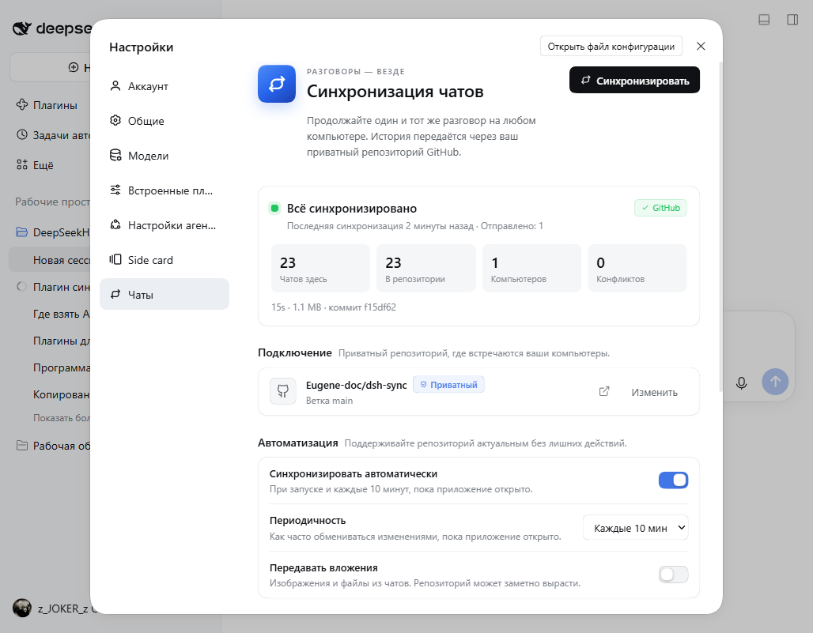

# Chat Sync

Небольшой плагин DeepSeek Harness, который переносит историю чатов между
компьютерами через один приватный репозиторий GitHub.



Английская версия — в свёрнутом блоке в конце файла.

## Что делает

- Хранит по одному снимку каждого компьютера в `devices/<device-id>/` внутри
  приватного Git-репозитория.
- Импортирует чаты, которых ещё нет на этом компьютере.
- Дописывает новые ходы, если локальный чат является точным префиксом удалённого.
- Не перезаписывает чат, который изменился в двух местах: локальная версия
  остаётся, а удалённая копия сохраняется в `~/.dsh/chat-sync/conflicts/`.
- Если у импортированного чата уже есть «тёзка», добавляет к названию имя
  компьютера-источника: `Программа рядом · Other PC`. Уже существующие
  одинаковые названия различаются при первой синхронизации после обновления.
  Это можно отключить.
- Показывает состояние, компьютеры, последние события, размер передачи и коммит
  в **Настройки → Чаты**.
- Кнопка **«Прикрепить чаты к рабочим областям»** раскладывает найденные сессии
  по подходящим рабочим областям. Содержимое чатов и архивные флаги не меняются.
- Синхронизирует архив: если чат архивирован на одном ПК, он остаётся скрытым и
  на остальных. Снятие с архива тоже передаётся.
- При конфликте одной и той же сессии оставляет самую свежую версию и заменяет
  старую. Заменённая копия сохраняется в `conflicts/`, поэтому данные не теряются
  безвозвратно.
- **Обновляет открытый чат без закрытия.** Если локальная копия — это начало
  более свежей удалённой, недостающие сообщения добавляются прямо в открытую
  сессию. Закрывать чат нужно только при реально разошедшихся ветках.
- В шапке чата справа есть иконка синхронизации, индикатор статуса и красная
  иконка **«Синхронизировать и перезапустить DSH»**.
- В настройках под обычной кнопкой синхронизации есть кнопка
  **«Синхронизировать и перезапустить DSH»**.
- По желанию передаёт вложения из чатов.
- Даёт ассистенту инструмент `chat_sync`, чтобы узнать статус или запустить
  синхронизацию.

Плагин намеренно **не читает** API-ключи, учётные данные, настройки плагинов,
рабочие области и файлы проектов. Всё, что вы написали в чате, является частью
его истории, поэтому репозиторий должен оставаться приватным. Страница настроек
спрашивает GitHub, действительно ли репозиторий приватный, и предупреждает,
если он публичный.

## Требования

- DeepSeek Harness **0.2.0-rc.1** или новее (Desktop или Web).
- [Git](https://git-scm.com/downloads) на каждом компьютере.
- Аккаунт GitHub, которому принадлежит приватный репозиторий с данными. Эта
  копия настроена на `Eugene-doc/dsh-sync`.
- В Windows один раз авторизуйте Git в этом аккаунте:

  ```powershell
  gh auth login --hostname github.com --git-protocol https --web
  gh auth setup-git
  ```

## Установка

### Обычная установка на любой компьютер

На этом компьютере плагин уже установлен. Чтобы поставить его на другой
компьютер или восстановить после переустановки, используйте пакет из релиза:

```powershell
& "$env:LOCALAPPDATA\Programs\DeepSeek Harness\resources\runtime\cli\bin\dsh.cmd" `
  plugin --profile desktop add `
  "https://github.com/Eugene-doc/dsh-chat-sync/releases/download/v1.5.1/dsh-chat-sync-1.5.1.tgz"
```

Полностью закройте и снова откройте DeepSeek Harness. Откройте
**Настройки → Чаты** и нажмите **Синхронизировать**. Репозиторий по умолчанию —
`Eugene-doc/dsh-sync`; на каждом компьютере войдите в один и тот же аккаунт
GitHub.

### Только для этого ПК: режим разработки

Этот вариант не нужен на новом компьютере. Команда ниже не скачивает пакет, а
подключает уже существующую папку с исходниками плагина:

```powershell
dsh plugin --profile desktop add "file:D:\My Drive\DeepSeekHarness\plugins\dsh-chat-sync"
```

> **Не выполняйте эту команду на новом ПК.** Там нет пути
> `D:\My Drive\DeepSeekHarness\plugins\dsh-chat-sync`, поэтому установка
> завершится ошибкой. На новом ПК используйте команду из раздела «Обычная
> установка» или скрипт восстановления ниже. Режим `file:` нужен только для
> разработки на компьютере, где лежит папка с исходниками.

## Обновление до 1.5.1

На каждом компьютере, где стоит 1.0.0–1.5.0, выполните:

```powershell
& "$env:LOCALAPPDATA\Programs\DeepSeek Harness\resources\runtime\cli\bin\dsh.cmd" `
  plugin --profile desktop add `
  "https://github.com/Eugene-doc/dsh-chat-sync/releases/download/v1.5.1/dsh-chat-sync-1.5.1.tgz"
```

Полностью закройте и снова откройте DeepSeek Harness. Откройте
**Настройки → Чаты** и нажмите **Синхронизировать**. Первая синхронизация
добавит имя компьютера к уже существующим одинаковым названиям; повторять
вручную ничего не нужно.

## Восстановление после переустановки Windows

Плагин и история чатов — разные вещи. Код плагина лежит в публичном
репозитории, а история — в приватном
[`Eugene-doc/dsh-sync`](https://github.com/Eugene-doc/dsh-sync).

### Что случится с данными

| Что | Где хранится | Переживёт переустановку Windows |
| --- | --- | --- |
| Код плагина | GitHub, публичный репозиторий | Да |
| История чатов | Приватный Git-репозиторий | Да, если последняя синхронизация успела загрузить изменения |
| Локальные сессии | `C:\Users\<user>\.dsh\sessions` | Нет, если диск C: отформатирован |
| API-ключи и настройки DSH | `C:\Users\<user>\.dsh\.credentials.yaml` и профиль | Нет, их нужно настроить заново |
| Вложения | Локально + репозиторий, если включён тумблер | Только если включена синхронизация вложений |

После чистой установки Windows локальная папка `.dsh` исчезнет. Всё, что было
загружено в приватный репозиторий, плагин скачает заново. Всё, что не успело
загрузиться, восстановить будет неоткуда.

### Способ 1: один скрипт

Откройте PowerShell от имени пользователя и выполните:

```powershell
irm https://raw.githubusercontent.com/Eugene-doc/dsh-chat-sync/main/scripts/install-windows.ps1 `
  -OutFile "$env:TEMP\chat-sync-install.ps1"

powershell -ExecutionPolicy Bypass -File "$env:TEMP\chat-sync-install.ps1"
```

Скрипт:

1. Проверит, установлен ли DeepSeek Harness, и при необходимости скачает
   официальный установщик.
2. Проверит Git и GitHub CLI, при необходимости поставит их через `winget`.
3. Попросит войти в GitHub как `Eugene-doc`.
4. Проверит доступ к приватному репозиторию `Eugene-doc/dsh-sync`.
5. Установит плагин из релиза
   [v1.5.1](https://github.com/Eugene-doc/dsh-chat-sync/releases/tag/v1.5.1).
6. Запишет конфигурацию по умолчанию.

После этого полностью закройте и откройте DeepSeek Harness, зайдите в
**Настройки → Чаты** и нажмите **Синхронизировать**.

Если `winget` недоступен, установите Git и GitHub CLI вручную с официальных
сайтов и запустите скрипт ещё раз.

### Способ 2: вручную

1. Установите [DeepSeek Harness](https://download.deepseek.com/desktop/dsh-latest-windows-x64.exe)
   и запустите его один раз, чтобы создался профиль.
2. Установите [Git](https://git-scm.com/downloads) и
   [GitHub CLI](https://cli.github.com/).
3. Войдите в GitHub и настройте Git:

   ```powershell
   gh auth login --hostname github.com --git-protocol https --web
   gh auth setup-git
   gh repo view Eugene-doc/dsh-sync --json visibility
   ```

4. Установите плагин:

   ```powershell
   & "$env:LOCALAPPDATA\Programs\DeepSeek Harness\resources\runtime\cli\bin\dsh.cmd" `
     plugin --profile desktop add `
     "https://github.com/Eugene-doc/dsh-chat-sync/releases/download/v1.5.1/dsh-chat-sync-1.5.1.tgz"
   ```

5. Полностью закройте и снова откройте DSH.
6. Откройте **Настройки → Чаты** и нажмите **Синхронизировать**.

### Если DSH не удаляли, а только переустановили

Папка `C:\Users\<user>\.dsh` может остаться на месте. Не удаляйте её до первой
синхронизации: локальные чаты и настройки плагина помогут восстановиться даже
без сети. После установки плагина нажмите **Синхронизировать** — плагин
объединит локальную историю с репозиторием.

### Что подготовить заранее

- Доступ к аккаунту GitHub `Eugene-doc`: пароль, второй фактор или recovery-коды.
- Успешную синхронизацию перед переустановкой: нажмите **Синхронизировать** и
  дождитесь зелёного статуса и коммита в приватном репозитории.
- При необходимости — копию папки `C:\Users\<user>\.dsh` на внешний диск.
- Отдельно сохраните API-ключи и настройки моделей: они не синхронизируются.
- Если нужны вложения, заранее включите **Передавать вложения** и дождитесь
  завершения синхронизации.

Подробная версия: [docs/reinstall.md](docs/reinstall.md).

## Использование

- **Синхронизировать** сразу обменивается изменениями. Кнопка недоступна, пока
  синхронизация уже идёт.
- **Синхронизировать автоматически** загружает изменения при запуске и каждые
  10 минут, пока приложение открыто. Можно выбрать 5, 10, 30 или 60 минут.
- **Передавать вложения** добавляет изображения и файлы из чатов. По умолчанию
  выключено, потому что репозиторий может быстро вырасти.
- **Добавлять имя компьютера к одинаковым названиям** включено по умолчанию.
  Если импортированный чат называется так же, как другой чат, к нему
  добавляется ` · Имя ПК`; при повторном совпадении — номер. Заголовок
  записывается в журнал сессии и синхронизируется как обычное изменение.
- **Прикрепить чаты к рабочим областям** — если после синхронизации часть
  чатов не видна в боковой панели. Кнопка прикрепляет их к подходящей рабочей
  области, не снимая архив. Сообщения и файлы сессий не меняются.
- **Синхронизировать архив** включено по умолчанию. Архивирование и снятие с
  архива передаются на другие компьютеры; архивные чаты остаются скрытыми.
- **Оставлять свежую версию при конфликте** включено по умолчанию. Если одна и
  та же сессия изменилась на двух ПК, более свежий журнал полностью заменяет
  старый. Старая версия остаётся в `conflicts/`.
  Это не объединяет два **разных** чата с одинаковым названием — они остаются
  разными сессиями с припиской компьютера.
- **Изменить** переключает на другой приватный репозиторий или ветку. Локальная
  копия пересоберётся при следующей синхронизации; локальные чаты не затрагиваются.
- Новые чаты с другого компьютера прикрепляются к рабочей области с тем же путём,
  затем к области с тем же именем папки, затем к первой доступной. Если список
  сессий не обновился сразу, может понадобиться перезапуск.

Перед переходом на другой компьютер нажмите **Синхронизировать**: таймер
периодической синхронизации не делает загрузку при завершении приложения.

## Как происходит объединение

DSH хранит каждый чат как append-only JSONL-журнал, сжатый Zstandard. Chat Sync
распаковывает кадры, сравнивает записи по последовательности и действует так:

| Локальная и удалённая версии | Результат |
| --- | --- |
| совпадают | ничего делать не нужно |
| локальная — точный префикс | удалённый хвост дописывается через `sessionPersistence` |
| удалённая — точный префикс | локальная версия сохраняется и загружается в этом запуске |
| истории расходятся | более свежая версия заменяет старую; заменённая копия — в `conflicts/` |

Чат, который сейчас открыт и принадлежит локальному writer, откладывается до
следующей синхронизации. Частично записанный журнал пропускается, а не
импортируется наполовину.

Каждый компьютер пишет только в свой каталог `devices/<id>/`, поэтому обычные
Git-push не конфликтуют. Рабочая копия репозитория с данными находится в
`~/.dsh/chat-sync/repo`.

## Где хранятся данные

```
devices/<device-id>/
  device.json       имя компьютера, платформа, последняя синхронизация
  manifest.json     индекс чатов (заголовок, рабочая область, хеш, размер, updatedAt)
  sessions/         append-only журналы сессий DSH
  attachments/      необязательные blobs с адресацией по содержимому
```

Локальное состояние:

```
config.json         репозиторий, ветка, автоматизация, вложения
state.json          id устройства, хеши выгруженного, конфликты, активность
repo/               локальная копия приватного репозитория
conflicts/          удалённые копии, которые разошлись с локальными
```

## Ограничения

- Сессии-форки (seeded) пропускаются, пока не поддерживается их раскладка
  унаследованного журнала. Обычные разговоры это не затрагивает.
- Разошедшиеся истории сохраняются, но не объединяются автоматически. Выберите
  сторону вручную; удалённая копия остаётся в `conflicts/`.
- Изменения вложений импортируются только при включённом **Передавать вложения**.
- Удаление сессии не передаётся на другие компьютеры.
- Кроссплатформенные чаты, чей путь проекта отсутствует на другом компьютере,
  прикрепляются к ближайшей рабочей области по имени папки, иначе к первой
  доступной. Вызовы инструментов внутри таких чатов всё равно ссылаются на
  старые пути.
- Выгружаются только ходы, уже сброшенные в журнал сессии; последние секунды
  живого хода могут подождать следующей синхронизации.

## Разработка

```powershell
cd "D:\My Drive\DeepSeekHarness\plugins\dsh-chat-sync"
node --test
node --check index.js
node --check client.js
```

У плагина нет runtime-зависимостей npm. Host-часть использует встроенные модули
Node и локальный `git`. Браузерная часть — обычный JavaScript, загружаемый через
`window.__ModuleLoader__`.

## Лицензия

MIT

<details>
<summary><b>English version</b></summary>

# Chat Sync

A small DeepSeek Harness plugin that carries conversation history between
computers through one private GitHub repository.

## What it does

- Keeps one snapshot per computer under `devices/<device-id>/` in a private
  Git repository.
- Imports chats that exist only on another computer.
- Appends newer turns when the local chat is an exact prefix of the remote one.
- Never rewrites a chat that changed in two places: it keeps the local copy and
  saves the remote copy under `~/.dsh/chat-sync/conflicts/`.
- Adds the source computer name to an imported chat when its title is already
  used: `Example chat · Other PC`. Existing duplicate titles are fixed on the
  first sync after the update. This can be turned off.
- Shows the relay state, computers, recent activity, transfer size and commit in
  **Settings → Chats**.
- The **Attach chats to workspaces** button places discovered sessions in their
  workspaces without changing archive flags. Chat content is not changed.
- Syncs the archive: a chat archived on one computer stays hidden on the others;
  unarchiving is propagated too.
- Resolves a divergent copy of the same session by keeping the newest version;
  the replaced copy stays in `conflicts/` as a backup.
- **Updates an open chat without closing it.** When the local copy is a prefix of
  the newer remote one, missing messages are appended to the live session. Closing
  is only required when the two branches genuinely diverged.
- The chat header's right side has a sync icon, a status indicator and a red
  **Sync and restart DSH** icon.
- The settings page also offers **Sync and restart DSH** under the normal sync
  button.
- Optionally carries content-addressed chat attachments.
- Exposes a `chat_sync` tool so the assistant can report status or run a sync.

It deliberately does **not** read API keys, credentials, plugin settings,
workspaces or project files. Anything you typed into a chat is part of that
chat's history, so the repository must stay private. The settings page asks
GitHub whether the relay is actually private and warns when it is public.

## Requirements

- DeepSeek Harness **0.2.0-rc.1** or newer (Desktop or Web).
- [Git](https://git-scm.com/downloads) on every computer.
- A GitHub account that owns the private data repository. This copy is set up
  for `Eugene-doc/dsh-sync`.
- On Windows, sign Git in to that account once:

  ```powershell
  gh auth login --hostname github.com --git-protocol https --web
  gh auth setup-git
  ```

## Install

### Normal installation on any computer

On this computer the plugin is already installed. To install it on another
computer or recover it after a reinstall, use the released package:

```powershell
& "$env:LOCALAPPDATA\Programs\DeepSeek Harness\resources\runtime\cli\bin\dsh.cmd" `
  plugin --profile desktop add `
  "https://github.com/Eugene-doc/dsh-chat-sync/releases/download/v1.5.1/dsh-chat-sync-1.5.1.tgz"
```

Fully quit and reopen DeepSeek Harness. Open **Settings → Chats** and press
**Sync now**. The default repository is `Eugene-doc/dsh-sync`; sign in to the
same GitHub account on every computer.

### This PC only: development mode

This option is not needed on a new computer. The command below does not download
a package; it links the existing source folder:

```powershell
dsh plugin --profile desktop add "file:D:\My Drive\DeepSeekHarness\plugins\dsh-chat-sync"
```

> **Do not run this on a new PC.** The path
> `D:\My Drive\DeepSeekHarness\plugins\dsh-chat-sync` does not exist there, so
> installation will fail. On a new PC use the command from “Normal installation”
> or the recovery script below. The `file:` mode is only for development on the
> computer that holds the source folder.

## Updating to 1.5.1

On every computer that still runs 1.0.0–1.5.0:

```powershell
& "$env:LOCALAPPDATA\Programs\DeepSeek Harness\resources\runtime\cli\bin\dsh.cmd" `
  plugin --profile desktop add `
  "https://github.com/Eugene-doc/dsh-chat-sync/releases/download/v1.5.1/dsh-chat-sync-1.5.1.tgz"
```

Fully quit and reopen DeepSeek Harness. Open **Settings → Chats** and press
**Sync now**. The first sync adds the computer name to existing duplicate titles;
no manual rename is needed.

## Reinstalling Windows or recovering the app

The plugin code is public; the chat data is private. After a clean Windows
install, run the bootstrap script:

```powershell
irm https://raw.githubusercontent.com/Eugene-doc/dsh-chat-sync/main/scripts/install-windows.ps1 `
  -OutFile "$env:TEMP\chat-sync-install.ps1"
powershell -ExecutionPolicy Bypass -File "$env:TEMP\chat-sync-install.ps1"
```

It installs DSH, Git and GitHub CLI if needed, signs in, installs the plugin and
writes the default configuration. Then restart DSH and press **Sync now** in
**Settings → Chats**.

### What survives

| Item | Location | Survives a Windows reinstall |
| --- | --- | --- |
| Plugin code | Public GitHub repository | Yes |
| Chat history | Private Git repository | Yes, if the last sync uploaded the changes |
| Local sessions | `C:\Users\<user>\.dsh\sessions` | No, after C: is formatted |
| API keys and DSH settings | `C:\Users\<user>\.dsh\.credentials.yaml` and the profile | No, configure them again |
| Attachments | Locally, plus the repository when enabled | Only when attachment sync was on |

### Before reinstalling

- Make sure you can sign in to the GitHub account `Eugene-doc`, including 2FA or
  recovery codes.
- Press **Sync now** and wait for the green state and a commit in the private
  repository.
- Copy `C:\Users\<user>\.dsh` to an external disk if you want a local backup.
- Save API keys and model settings separately; they are not synced.
- If you need attachments, enable **Include attachments** and let the sync finish.

See [the recovery guide](docs/reinstall.md) for the manual route and more detail.

## Use

- **Sync now** exchanges changes immediately. The button is disabled while a
  sync is running.
- **Sync automatically** pulls on launch and exchanges changes every 10 minutes
  while the app is open. You can choose 5, 10, 30 or 60 minutes.
- **Include attachments** adds images and files referenced by chats. It is off
  by default because the relay can grow quickly.
- **Add computer name to duplicate titles** is on by default. When an imported
  chat has the same title as another chat, ` · PC name` is appended (with a
  number on further collisions). The title is written to the session log and
  syncs like any other change.
- **Attach chats to workspaces** repairs a sidebar that does not show some
  synchronized chats. It attaches each session to its workspace without changing
  archive flags. Messages and session files are not changed.
- **Sync the archive** is on by default. Archiving and unarchiving are propagated
  to the other computers; archived chats stay hidden.
- **Keep the newest version on conflict** is on by default. If the same session
  changed on two PCs, the newer log fully replaces the older one; the replaced
  copy stays in `conflicts/`. This does not merge two **different** chats that
  happen to have the same title — they remain separate sessions with a computer
  suffix.
- **Change** switches to another private GitHub repository or branch. The local
  checkout is rebuilt on the next sync; local chats are untouched.
- New chats imported from another computer are attached to a workspace with the
  same path, then the same folder name, then the first available workspace.
  A restart may be needed if the session list does not refresh immediately.

Press **Sync now before quitting** if you are about to move to another computer;
the periodic timer does not run an upload during shutdown.

## How the merge works

DSH stores each chat as an append-only, Zstandard-compressed JSONL log. Chat Sync
decodes the frames, compares records by sequence, and:

| Local vs remote | Result |
| --- | --- |
| equal | nothing to do |
| local is an exact prefix | append the remote tail through `sessionPersistence` |
| remote is an exact prefix | keep local, upload it on this run |
| divergent | keep local, save the remote bytes as a conflict copy |

A chat that is currently open and owned by the local writer is deferred to the
next sync. A partially written log is skipped rather than half-imported.

Each computer writes only its own `devices/<id>/` directory, so normal Git
pushes do not conflict. The data repository is cloned to
`~/.dsh/chat-sync/repo`.

## Data layout

```
devices/<device-id>/
  device.json       computer name, platform, last sync
  manifest.json     chat index (title, workspace, hash, size, updatedAt)
  sessions/         append-only DSH session logs
  attachments/      optional content-addressed blobs
```

Local state lives in `~/.dsh/chat-sync/`:

```
config.json         remote, branch, automation, attachments
state.json          device id, exported hashes, conflicts, activity
repo/               local clone of the private repository
conflicts/          remote copies that diverged
```

## Limitations

- Seeded (forked) sessions are skipped until their inherited-log layout is
  supported. Ordinary conversations are unaffected.
- Divergent histories are preserved, not automatically merged. Resolve them by
  choosing one side manually; the remote copy remains in `conflicts/`.
- Attachment changes are imported only when **Include attachments** is on.
- Session deletion is not propagated.
- Cross-platform chats whose project path does not exist on the other computer
  are attached to the closest workspace by folder name, otherwise to the first
  available workspace. Tool calls inside those chats still reference the old
  paths.
- Only turns already flushed to the session log are exported; the last few
  seconds of a live turn may wait for the next sync.

## Development

```powershell
cd "D:\My Drive\DeepSeekHarness\plugins\dsh-chat-sync"
node --test
node --check index.js
node --check client.js
```

The plugin has no runtime npm dependencies. Host code uses Node built-ins and
the local `git` executable. The browser half is plain JavaScript loaded through
`window.__ModuleLoader__`.

## License

MIT

</details>
